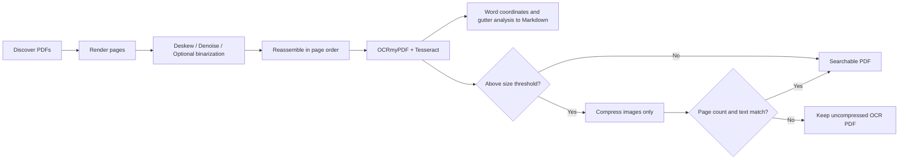

<div align="center">

# PDF Batch OCR

**Local-first batch multilingual OCR for scanned books**

**English** · [简体中文](README.zh-CN.md)

</div>

PDF Batch OCR processes folders of scanned-book PDFs locally, with configurable Tesseract recognition languages, image preprocessing, controlled parallelism, searchable text layers, structured Markdown output, and text-safe conditional compression.

No PDF or OCR content is uploaded by this program. Only process documents that you are authorized to use.

## Features

- Discover PDFs in a folder, with optional recursive scanning.
- Render pages at 300 DPI, correct small-angle skew, remove noise, preserve color, and use JPEG encoding by default.
- Optionally apply adaptive or Otsu binarization to text-only scans, producing compact 1-bit black-and-white pages.
- Preprocess pages in up to four independent processes while preserving page order.
- Recognize any installed Tesseract language or language combination through `--language`; the default is Simplified Chinese and English (`chi_sim+eng`).
- Add an invisible, searchable OCR text layer.
- Generate Markdown by default with page boundaries, paragraph joining, and English dehyphenation.
- Compress page images only when the result exceeds 50 MB.
- Compare page count and extracted text before accepting a compressed result.
- Continue processing the batch when an individual file fails.

## Pipeline



The default workflow:

1. Renders each page at 300 DPI and corrects small-angle skew.
2. Applies median denoising.
3. Preserves RGB color and encodes pages as JPEG at quality 72 by default; selecting `adaptive` or `otsu` produces 1-bit black-and-white PNG pages instead.
4. Uses OCRmyPDF and Tesseract to add an invisible, searchable text layer.
5. Runs structured Tesseract OCR on the preprocessed pages, then uses word coordinates and column-gutter analysis to restore reading order and generate Markdown.
6. If the OCR result exceeds 50 MB (50,000,000 bytes), Ghostscript downsamples and compresses page images only.
7. Compares page counts and extractable text before and after compression. If verification fails, the uncompressed OCR file is kept.

Recognition languages are configurable through `--language` and may use any language data installed in Tesseract. The default is Simplified Chinese and English: `chi_sim+eng`.

## Quick start

Python 3.11 or later is required, along with these system programs:

- Tesseract OCR with the language data required for your chosen languages (`chi_sim` and `eng` for the default configuration).
- Ghostscript for image compression above the configured threshold.
- Noto CJK fonts are recommended so recent OCRmyPDF versions can construct CJK text layers correctly.

For Windows installation details, see the [OCRmyPDF native Windows installation guide](https://ocrmypdf.readthedocs.io/en/latest/installation.html#native-windows).

### Conda (recommended)

```powershell
conda env create -f environment.yml
conda activate pdf-batch-ocr
```

Some Windows Conda packages install Tesseract language data and output configurations in different directories. If you encounter `Can't open hocr`, run this once:

```powershell
.\scripts\repair_conda_tessdata.ps1
```

Verify the environment:

```powershell
python -m pip check
python -m ocrmypdf --version
tesseract --list-langs
gswin64c -version
```

### venv + pip

First verify that the system executables are available:

```powershell
tesseract --version
tesseract --list-langs
gswin64c -version
```

Create a virtual environment and install the Python dependencies:

```powershell
python -m venv .venv
.\.venv\Scripts\Activate.ps1
python -m pip install --upgrade pip
python -m pip install -r requirements.txt
```

You can also install the project as a command-line tool:

```powershell
python -m pip install -e .
pdf-batch-ocr "D:\Books\ToProcess"
```

## Usage

Process every PDF in a folder:

```powershell
python .\batch_ocr.py "D:\Books\ToProcess"
```

Preprocessing uses up to four independent processes by default. Adjust this for available CPU and memory:

```powershell
python .\batch_ocr.py "D:\Books\ToProcess" --preprocess-jobs 4
```

Use serial preprocessing when memory is limited:

```powershell
python .\batch_ocr.py "D:\Books\ToProcess" --preprocess-jobs 1
```

Results are written to `D:\Books\ToProcess\ocr_output` by default. Each book produces both `book_ocr.pdf` and `book_ocr.md`. If the PDF already exists but its Markdown file does not, the script creates Markdown from the existing text layer as a best-effort fallback. When both outputs exist, the book is skipped; use `--overwrite` to regenerate them.

Specify an output directory and scan recursively:

```powershell
python .\batch_ocr.py "D:\Books\ToProcess" -o "D:\Books\Completed" --recursive
```

Adjust JPEG quality, the size threshold, and later image-compression settings:

```powershell
python .\batch_ocr.py "D:\Books\ToProcess" `
  --compression-threshold-mb 50 `
  --compression-dpi 200 `
  --jpeg-quality 72
```

For smaller files and cleaner backgrounds in text-only scans, enable adaptive binarization:

```powershell
python .\batch_ocr.py "D:\Books\ToProcess" --binarization adaptive
```

If you only need a searchable PDF, disable Markdown output:

```powershell
python .\batch_ocr.py "D:\Books\ToProcess" --no-markdown
```

If you only need Markdown, skip searchable-PDF generation and conditional compression:

```powershell
python .\batch_ocr.py "D:\Books\ToProcess" --markdown-only
```

To also create a WeRead-oriented Markdown copy while preserving the original Markdown:

```powershell
python .\batch_ocr.py "D:\Books\ToProcess" --weread-markdown
```

The additional file is named `book_ocr_weread.md`. It removes recurring running headers and standalone page numbers, renders trailing numbered footnotes as visible note blocks, and inserts reading sections before they reach 64 KiB.

Choose any installed Tesseract language or language combination—for example, Traditional Chinese and English:

```powershell
python .\batch_ocr.py "D:\Books\ToProcess" --language chi_tra+eng
```

Show every available option:

```powershell
python .\batch_ocr.py --help
```

## Recommended settings

| Document type | Recommendation |
|---|---|
| Photographs, color pages, or detailed grayscale illustrations | Default `--binarization none`; preserve color and use JPEG |
| Yellowed or uneven text-only pages | `--binarization adaptive` |
| Scans with a uniform background | `--binarization otsu` |
| Salt-and-pepper noise | Default `--denoise median` |
| Light continuous noise | `--denoise nlm --denoise-strength 7` |
| Small type or annotations in historical books | Keep `--dpi 300`; avoid an excessively low compression DPI |

The compression stage does not rasterize the whole page. Ghostscript is configured to downsample and encode images while retaining text and font objects as the text layer. The script also reads each page's text layer before and after compression; a result is rejected unless the extracted text matches exactly.

## Notes

- Default `--binarization none` preserves RGB color and encodes preprocessed pages as JPEG. `--jpeg-quality` controls both this encoding and JPEG compression applied to results above the size threshold.
- `--binarization adaptive` and `--binarization otsu` convert pages to black and white and save true 1-bit PNG files, which usually works better for text-only scans.
- Markdown uses Tesseract TSV word coordinates and column-gutter detection to restore reading order. Regular two-column pages are emitted as the complete left column followed by the right column, while paragraph breaks are retained, wrapped lines are joined, and English end-of-line hyphenation is repaired.
- Word coordinates require an additional structured Tesseract pass when Markdown is enabled, so total processing takes longer than PDF-only output. Use `--no-markdown` to disable it.
- `--markdown-only` runs the page preprocessing and structured Tesseract pass directly, but skips OCRmyPDF, PDF assembly, and Ghostscript compression. It cannot be combined with `--no-markdown`.
- `--weread-markdown` keeps the original `*_ocr.md` unchanged and adds `*_ocr_weread.md`. It can also backfill the WeRead copy from an existing Markdown file without rerunning OCR.
- WeRead footnote formatting is deliberately conservative: only consecutive numbered paragraphs at the end of a page are converted. OCR-damaged in-text note markers are not automatically linked.
- Markdown is a content-structure copy, not a reproduction of PDF fonts or exact coordinates. Complex tables, spanning headings, and irregular layouts may still require manual editing or a specialized layout-analysis model.
- Deskew corrects common small-angle page skew; OCRmyPDF handles 90/180/270-degree orientation with automatic rotation.
- `--preprocess-jobs` controls parallel rendering, deskewing, denoising, optional binarization, and JPEG/PNG encoding. `--jobs` controls the later OCR stage only.
- A failed PDF does not stop other files in the batch. A summary of successful, skipped, and failed files is printed at the end.
- Use `--keep-temp` to retain preprocessed pages and intermediate PDFs when diagnosing unusual layouts.
- `books/`, all PDFs, and OCR intermediate files are ignored by Git by default to avoid uploading private or copyrighted documents.

## Development and testing

See the [project roadmap](ROADMAP.md) for the planned README demo, Windows
installer, and desktop interface.

The base test suite uses Python's standard-library `unittest` and does not require OCR system programs:

```powershell
python -m py_compile .\batch_ocr.py .\tests\test_batch_ocr.py
python -m unittest discover -s tests -v
```

Read [CONTRIBUTING.md](CONTRIBUTING.md) before contributing. Do not attach confidential or copyrighted PDFs to bug reports.

## License

This project is licensed under the [MIT License](LICENSE). Tesseract, Ghostscript, OCRmyPDF, and other third-party dependencies remain subject to their respective licenses.
