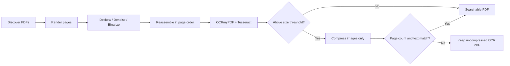

<div align="center">

# PDF Batch OCR

**Local-first batch Chinese and English OCR for scanned books**

**English** · [简体中文](README.zh-CN.md)

</div>

PDF Batch OCR processes folders of scanned-book PDFs locally, with image preprocessing, controlled parallelism, searchable text layers, and text-safe conditional compression.

No PDF or OCR content is uploaded by this program. Only process documents that you are authorized to use.

## Features

- Discover PDFs in a folder, with optional recursive scanning.
- Render pages at 300 DPI, correct small-angle skew, remove noise, and apply adaptive binarization.
- Preprocess pages in up to four independent processes while preserving page order.
- Recognize Simplified Chinese and English with `chi_sim+eng` by default.
- Add an invisible, searchable OCR text layer.
- Compress page images only when the result exceeds 50 MB.
- Compare page count and extracted text before accepting a compressed result.
- Continue processing the batch when an individual file fails.

## Pipeline



The default workflow:

1. Renders each page at 300 DPI and corrects small-angle skew.
2. Applies median denoising.
3. Applies adaptive binarization.
4. Uses OCRmyPDF and Tesseract to add an invisible, searchable text layer.
5. If the OCR result exceeds 50 MB (50,000,000 bytes), Ghostscript downsamples and compresses page images only.
6. Compares page counts and extractable text before and after compression. If verification fails, the uncompressed OCR file is kept.

The default recognition languages are Simplified Chinese and English: `chi_sim+eng`.

## Quick start

Python 3.11 or later is required, along with these system programs:

- Tesseract OCR with the `chi_sim` and `eng` language data.
- Ghostscript for image compression above the configured threshold.
- Noto CJK fonts are recommended so recent OCRmyPDF versions can construct CJK text layers correctly.

For Windows installation details, see the [OCRmyPDF native Windows installation guide](https://ocrmypdf.readthedocs.io/en/latest/installation.html#native-windows).

### Conda (recommended)

```powershell
conda env create -f environment.yml
conda activate pdf-batch-ocr
```

Some Windows Conda packages install Tesseract language data and output configurations in different directories. If you encounter `Can't open hocr`, run this once:

```powershell
.\scripts\repair_conda_tessdata.ps1
```

Verify the environment:

```powershell
python -m pip check
python -m ocrmypdf --version
tesseract --list-langs
gswin64c -version
```

### venv + pip

First verify that the system executables are available:

```powershell
tesseract --version
tesseract --list-langs
gswin64c -version
```

Create a virtual environment and install the Python dependencies:

```powershell
python -m venv .venv
.\.venv\Scripts\Activate.ps1
python -m pip install --upgrade pip
python -m pip install -r requirements.txt
```

You can also install the project as a command-line tool:

```powershell
python -m pip install -e .
pdf-batch-ocr "D:\Books\ToProcess"
```

## Usage

Process every PDF in a folder:

```powershell
python .\batch_ocr.py "D:\Books\ToProcess"
```

Preprocessing uses up to four independent processes by default. Adjust this for available CPU and memory:

```powershell
python .\batch_ocr.py "D:\Books\ToProcess" --preprocess-jobs 4
```

Use serial preprocessing when memory is limited:

```powershell
python .\batch_ocr.py "D:\Books\ToProcess" --preprocess-jobs 1
```

Results are written to `D:\Books\ToProcess\ocr_output` by default, with names such as `book_ocr.pdf`. Existing outputs are skipped; use `--overwrite` to regenerate them.

Specify an output directory and scan recursively:

```powershell
python .\batch_ocr.py "D:\Books\ToProcess" -o "D:\Books\Completed" --recursive
```

Adjust the size threshold and image-compression settings:

```powershell
python .\batch_ocr.py "D:\Books\ToProcess" `
  --compression-threshold-mb 50 `
  --compression-dpi 200 `
  --jpeg-quality 72
```

Disable binarization for documents containing many photographs or illustrations:

```powershell
python .\batch_ocr.py "D:\Books\ToProcess" --binarization none
```

Recognize Traditional Chinese and English:

```powershell
python .\batch_ocr.py "D:\Books\ToProcess" --language chi_tra+eng
```

Show every available option:

```powershell
python .\batch_ocr.py --help
```

## Recommended settings

| Document type | Recommendation |
|---|---|
| Yellowed or uneven text pages | Default `--binarization adaptive` |
| Scans with a uniform background | `--binarization otsu` |
| Photographs, color pages, or detailed grayscale illustrations | `--binarization none` |
| Salt-and-pepper noise | Default `--denoise median` |
| Light continuous noise | `--denoise nlm --denoise-strength 7` |
| Small type or annotations in historical books | Keep `--dpi 300`; avoid an excessively low compression DPI |

The compression stage does not rasterize the whole page. Ghostscript is configured to downsample and encode images while retaining text and font objects as the text layer. The script also reads each page's text layer before and after compression; a result is rejected unless the extracted text matches exactly.

## Notes

- Default binarization converts color pages to black and white. Use `--binarization none` when important images are present.
- Deskew corrects common small-angle page skew; OCRmyPDF handles 90/180/270-degree orientation with automatic rotation.
- `--preprocess-jobs` controls parallel rendering, deskewing, denoising, binarization, and PNG encoding. `--jobs` controls the later OCR stage only.
- A failed PDF does not stop other files in the batch. A summary of successful, skipped, and failed files is printed at the end.
- Use `--keep-temp` to retain preprocessed pages and intermediate PDFs when diagnosing unusual layouts.
- `books/`, all PDFs, and OCR intermediate files are ignored by Git by default to avoid uploading private or copyrighted documents.

## Development and testing

The base test suite uses Python's standard-library `unittest` and does not require OCR system programs:

```powershell
python -m py_compile .\batch_ocr.py .\tests\test_batch_ocr.py
python -m unittest discover -s tests -v
```

Read [CONTRIBUTING.md](CONTRIBUTING.md) before contributing. Do not attach confidential or copyrighted PDFs to bug reports.

## License

This project is licensed under the [MIT License](LICENSE). Tesseract, Ghostscript, OCRmyPDF, and other third-party dependencies remain subject to their respective licenses.
