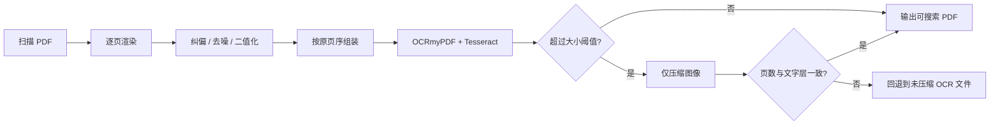

<div align="center">

# PDF Batch OCR

**面向扫描版书籍的本地批量多语言 OCR 工具**

[English](README.md) · **简体中文**

</div>

本工具在本地批量处理扫描版书籍 PDF，识别语言可通过 `--language` 配置，并提供图像预处理、受控并行和文字层安全校验。

> A local-first batch OCR pipeline for scanned books, with configurable Tesseract languages,
> image preprocessing, controlled parallelism, and text-layer-safe compression.

所有文档均在本机处理，程序不会上传 PDF 或 OCR 内容。请仅处理你有权使用的文档。

## 功能

- 自动发现文件夹中的 PDF，可选择递归扫描；
- 300 DPI 页面渲染、小角度纠偏、去噪和自适应二值化；
- 最多 4 个独立进程并行预处理，并保持原始页序；
- 可通过 `--language` 使用任意已安装的 Tesseract 语言或语言组合，默认值为简体中文和英文（`chi_sim+eng`）；
- 生成不可见、可搜索的 OCR 文字层；
- 成品超过 50 MB 时仅压缩页面图像；
- 压缩前后逐页核对文字内容，校验失败时保留未压缩版本；
- 单个文件失败不会中断整批任务。

## 处理流程



默认流程是：

1. 以 300 DPI 逐页渲染，自动估计并纠正小角度倾斜；
2. 中值去噪；
3. 自适应二值化；
4. 使用 OCRmyPDF + Tesseract 写入不可见、可搜索的文字层；
5. OCR 成品超过 50 MB（50,000,000 字节）时，使用 Ghostscript 只对页面图像降采样/压缩；
6. 比较压缩前后的页数和可提取文字量。校验失败时自动保留未压缩的 OCR 文件。

识别语言可通过 `--language` 配置，支持 Tesseract 中已安装的任意语言数据。默认值为简体中文和英文：`chi_sim+eng`。

## 快速开始

需要 Python 3.11+，以及系统程序：

- Tesseract OCR，并安装所选语言需要的语言数据（默认配置需要 `chi_sim` 和 `eng`）；
- Ghostscript（超阈值的图像压缩所需）；
- 推荐安装 Noto CJK 字体，供新版 OCRmyPDF 正确构造中日韩文字层。

Windows 的 Tesseract、Ghostscript 与 OCRmyPDF 安装方式可参考
[OCRmyPDF 官方安装说明](https://ocrmypdf.readthedocs.io/en/latest/installation.html#native-windows)。

### Conda（推荐）

```powershell
conda env create -f environment.yml
conda activate pdf-batch-ocr
```

部分 Windows Conda 构建会把 Tesseract 语言数据和输出配置装到不同目录。如果运行时出现
`Can't open hocr`，执行一次：

```powershell
.\scripts\repair_conda_tessdata.ps1
```

检查环境：

```powershell
python -m pip check
python -m ocrmypdf --version
tesseract --list-langs
gswin64c -version
```

### venv + pip

确认命令行能够找到它们：

```powershell
tesseract --version
tesseract --list-langs
gswin64c -version
```

创建虚拟环境并安装 Python 依赖：

```powershell
python -m venv .venv
.\.venv\Scripts\Activate.ps1
python -m pip install --upgrade pip
python -m pip install -r requirements.txt
```

也可以把项目安装为命令行工具：

```powershell
python -m pip install -e .
pdf-batch-ocr "D:\Books\待处理"
```

## 使用

处理一个文件夹里的全部 PDF：

```powershell
python .\batch_ocr.py "D:\Books\待处理"
```

预处理默认最多使用 4 个独立进程。可根据 CPU 和内存调整：

```powershell
python .\batch_ocr.py "D:\Books\待处理" --preprocess-jobs 4
```

内存不足或需要恢复串行处理时：

```powershell
python .\batch_ocr.py "D:\Books\待处理" --preprocess-jobs 1
```

结果默认写入 `D:\Books\待处理\ocr_output`，文件名形如 `书名_ocr.pdf`。输出存在时会跳过；确认需要重做可加 `--overwrite`。

指定输出目录并递归处理：

```powershell
python .\batch_ocr.py "D:\Books\待处理" -o "D:\Books\OCR完成" --recursive
```

调整阈值和图像压缩参数：

```powershell
python .\batch_ocr.py "D:\Books\待处理" `
  --compression-threshold-mb 50 `
  --compression-dpi 200 `
  --jpeg-quality 72
```

有大量照片或插图、不希望二值化时：

```powershell
python .\batch_ocr.py "D:\Books\待处理" --binarization none
```

指定任意已安装的 Tesseract 语言或语言组合，例如繁体中文和英文：

```powershell
python .\batch_ocr.py "D:\Books\待处理" --language chi_tra+eng
```

查看全部可调参数：

```powershell
python .\batch_ocr.py --help
```

## 参数建议

| 场景 | 建议 |
|---|---|
| 泛黄、明暗不均的纯文字书 | 默认 `--binarization adaptive` |
| 背景较均匀的扫描件 | `--binarization otsu` |
| 含照片、彩图或细腻灰阶插图 | `--binarization none` |
| 椒盐噪点 | 默认 `--denoise median` |
| 轻微连续噪声 | `--denoise nlm --denoise-strength 7` |
| 小字、古籍批注 | 可保留 `--dpi 300`，不要把压缩 DPI 调得过低 |

压缩阶段不会把整页重新栅格化：Ghostscript 只设置图像降采样和图像编码参数，文字及字体对象仍作为文字层处理。脚本还会逐页读取压缩前后的文字层；若文字内容不是完全一致，压缩结果不会被采用。

## 注意事项

- 默认二值化会把彩色页转为黑白。含有重要图片时使用 `--binarization none`。
- 自动纠偏处理的是常见的小角度歪斜；90/180/270 度方向由 OCRmyPDF 的自动旋转处理。
- `--preprocess-jobs` 控制渲染、纠偏、去噪、二值化和 PNG 编码的并行进程数；`--jobs` 仅控制后续 OCR。
- 单个 PDF 失败不会中断同一批次中的其他文件；最后会打印成功、跳过和失败汇总。
- 使用 `--keep-temp` 可以保留预处理页面和中间 PDF，便于排查特殊版面。
- `books/`、所有 PDF 和 OCR 中间产物默认被 Git 忽略，避免误上传私人或受版权保护的文档。

## 开发与测试

项目使用 Python 标准库 `unittest`，基础测试不依赖 OCR 系统程序：

```powershell
python -m py_compile .\batch_ocr.py .\tests\test_batch_ocr.py
python -m unittest discover -s tests -v
```

贡献前请阅读 [CONTRIBUTING.md](CONTRIBUTING.md)。Bug 报告中不要上传机密或受版权保护的 PDF。

## 许可证

本项目使用 [MIT License](LICENSE)。Tesseract、Ghostscript、OCRmyPDF 及其他第三方依赖分别适用其自身许可证。
